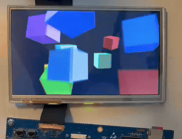

# GPU LTDC Demo — spinning cubes

This project combines the `gpu/` and display projects by rendering 12 (or more)
moving/spinning cubes at about 60fps onto a display. The number of cubes can be
increased in the source code. Sources are pulled from `gpu/` and one of the `ltdc-lvds/`, `ltdc-dsi/` or
`ltdc-rgb/` projects, depending on the board and `DISPLAY=` option (see below).

## Display target

The display path is chosen with `DISPLAY=lvds | dsi | rgb`; the default follows
the board:

- `make` (`BOARD=ev1`, default `DISPLAY=lvds`) — 1024×600 LVDS display on
  the EV1, using the `ltdc-lvds/` project.
- `make BOARD=devboard` (default `DISPLAY=dsi`) — 720×1280 MIPI-DSI
  ILI9881C panel on the custom devboard, using `ltdc-dsi/` (and USART1 for the
  console).
- `make BOARD=devboard DISPLAY=rgb` — the 720×720 parallel RGB panel
  on the custom devboard, using `ltdc-rgb/`

All three display paths expose the same `display_init()` / `ltdc_*` API and a
`Panel` namespace (`HActive`/`VActive`), so `main.cc` is display-agnostic apart
from including the matching `panel_*.hh`.

All cubes are rendered into one full-screen tiled render target with a shared
depth buffer, so the depth test resolves occlusion between them, though there 
is no collision detection and so cubes will pass through each other (but z-depth
will determine which one is seen).
Each cube has a world position, velocity, spin rate, and base hue (faces are
shades of the base hue).

The display is double-buffered, and the refresh is interrupt-driven via an ltdc callback.

## Performance

Overall performance is excellent: we easily hit 60 fps with up to around 100 cubes.
At 12 cubes, render time is 4-6ms on the 1024x600 LVDS EV1 display at 60fps (~123px/us),
and 8-12ms on the 720x1280 MIPI DSI display at 57fps (92px/us), and 5-8ms on the 720x720 RGB
display at 54fps (79px/us). The longer render times per pixel on the devboard is
likely due the single DDR4 chip on the devboard vs dual DDR4 chips on the EV1. 


## Expected output

You should see color cubes spinning on the screen.



```
GPU -> LTDC demo: composited spinning cube
==========================================

etna: bringing up GPU
etna: VDDGPU not present (CR12 = 0x0)
etna: VDDGPU off -- trying to enable buck3 over I2C7...
pmic: product ID 0x20, version 0x11
pmic: Buck3 (VDDGPU) was: voltage code 0, control 0x0
pmic: Buck3 (VDDGPU) now: voltage code 40 (900mV), control 0x1
etna: gpu pll set to 800 MHz
etna: GPU mem-clock ~600 MHz

etna: GC model 0x8000 rev 0x6205 (product 0x80003, customer 0x15)
Display up: 12 cubes
Spinning...
60 fps, worst render 5207 us
60 fps, worst render 5819 us
60 fps, worst render 5858 us
```

You can edit NCubes in main.cc to increase the cube count.

You also can compile with DDRPERF=1 to see some DDR/GPU stats:

```bash
make DDRPERF=1
```

```
[...]
Spinning...
61 fps, worst render 5184 us
  [DDRPERFM] 1 frame render: wr=222889 rd=208078 act=164278 pre=164271 tcnt=728424
    write 6965 KiB, read 6502 KiB, DDR-busy 59.1% , wr ~1468 MB/s
    1.3 writes/activate (164278 ACT, 164271 PRE) -- high is good; ~1 => row-thrashing
    expected ~4800 KiB written; measured/expected = 145%
    verdict: partial -> DDR neither idle nor saturated; look at burst size / outstanding
    render wall = 4775 us,DDR bursts/us (tcnt/us) = 152
```

